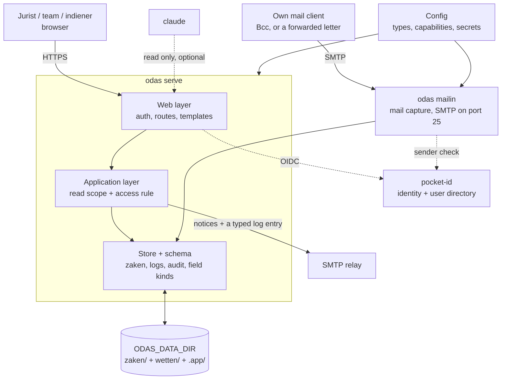

# ODAS architecture

This is the durable technical context. Behaviour belongs in the shipped Dutch
[manual](src/odas/builtin/handleiding.md); executable detail belongs in code,
tests, and example data. Known work belongs in the [backlog](wip/backlog.md).

## Purpose and record

ODAS keeps a legal case file usable after the application is gone.

**A zaak is a folder of plain files.** `index.md` frontmatter is its state; the
folder is its record. Do not make a database, cache, or service the only place
where case information exists. Derived data is allowed only when it can be
discarded and rebuilt from that folder.

## Shape

**Stack:** Python 3.12+, FastAPI, Jinja2 for server-rendered HTML, `aiosmtpd` for
capture, `dkimpy` for sender checks, pocket-id for identity. No database of
record, no queue, no client build step.

- **Every page is a full page, rendered from disk on request.** Nothing on screen
  can disagree with the folder behind it. A slow page beats a stale one.
- **The app serves its own front end.** Libraries are vendored and no page
  fetches from another host. A test enforces it; map tiles are the one exception.
  A data dir may declare a visitor counter, which is the only host the code lets
  a deployment add. It is off unless declared, and never on a token page.
- **Two inbound interfaces: the browser and the mail port.** An agent reads the
  volume itself, as a person with a file manager does, so it needs no third
  surface and no endpoint of its own. The read verbs of the command line are a
  projection of those files, not a surface of their own. The dev JSON route
  serves the import agent, and is not a further product surface.

## Invariants

- The data directory owns schema, branding, capabilities, and identity setup.
  A missing declaration means a missing feature; configuration does not merge
  with organisation-specific code.
- One image can serve many data directories, but each process has one
  `ODAS_DATA_DIR`. There are no organisation-specific code paths.
- The browser is server-rendered from disk. There is no SPA or public API.
  The application boundary is in-process.
- The browser and inbound SMTP are the only write interfaces. The terminal and
  agents read the folder; they do not need another product surface.
- Identity is provided by pocket-id; access is decided from the zaak on each
  request. A share token grants read access to that zaak only.
- The application writes files and keeps an append-only audit trail. Deletion
  moves a case to the data directory's `prullenbak`; browser deletion never
  permanently removes it.
- Documents, extracted text, and optional AI summaries live beside the log entry
  that owns them. Extraction is disposable; a summary is explicit and may cost
  money.
- No workflow engine: fields such as status and deadline are the workflow.
  No multi-tenant service: one data directory is one organisation.

## Configurations used in tests

| Configuration | Use |
|---|---|
| `solo` | One person handling procedures. |
| `vms` | A small team and tracked laws. |
| `veenwacht` | A helpdesk that also accepts public intake. |

These are configurations, not editions. A change must work against the data
that declares the capability, rather than checking an organisation name.
