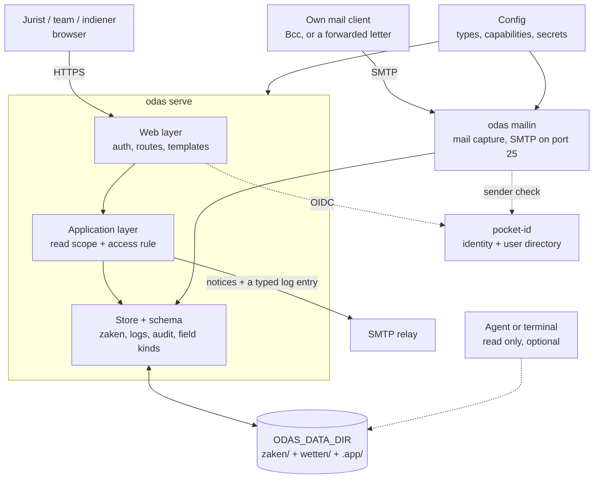

# ODAS architecture

This file holds the durable technical context. Behaviour is in the Dutch
[manual](src/odas/builtin/handleiding.md). Detail is in the code, the tests and
the example data. Known work is in the [backlog](wip/backlog.md).

## Purpose

ODAS keeps a legal case file usable after the application is gone.

**A zaak is a folder of plain files.** The `index.md` frontmatter is its state.
The folder is its record. A database, cache or service must never be the only
place that holds case information. Derived data is permitted only if you can
delete it and build it again from the folder.

## Shape

**Stack:** Python 3.12+, FastAPI, Jinja2 for server-rendered HTML, `aiosmtpd` for
mail capture, `dkimpy` for sender checks, pocket-id for identity. There is no
database of record, no queue and no client build step.

## Invariants

- **The data dir owns all behaviour.** `.app/config.yaml` declares schema,
  branding, capabilities and identity setup. A missing declaration is a missing
  feature. No code path checks an organisation name.
- **One process, one data dir.** One image can serve many data dirs. Each process
  has one `ODAS_DATA_DIR`. There is no multi-tenant service.
- **Each page is rendered from disk on request.** The screen cannot disagree with
  the folder. A slow page is better than a stale page. There is no SPA and no
  public API.
- **Two write interfaces: the browser and inbound SMTP.** Agents and the command
  line read the folder directly. The dev JSON route serves the import agent only.
- **No page fetches from another host.** Libraries are vendored, and a test
  enforces this. Map tiles are the one exception. A data dir can declare a
  visitor counter. It is off by default and never on a token page.
- **Access is decided from the zaak on each request.** pocket-id gives identity.
  A share token gives read access to that one zaak.
- **The audit trail is append-only.** A browser delete moves the zaak to
  `prullenbak`. It never removes the zaak permanently.
- **Documents live beside their log entry**, with their extracted text and an
  optional AI summary. Extraction is disposable. A summary is explicit, because
  it can cost money.
- **No workflow engine.** Fields such as status and deadline are the workflow.

## Test configurations

| Data dir | Use |
|---|---|
| `solo` | One person who handles procedures. |
| `vms` | A small team that tracks laws. |
| `veenwacht` | A helpdesk with public intake. |

These are configurations, not editions. Test a change against the data dir
that declares the capability.
